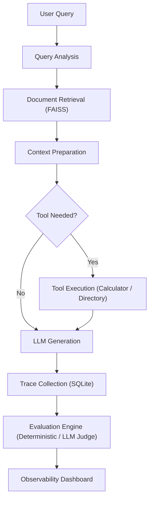

# AI Agent Evaluation and Observability Platform: Architecture & System Design

**Institution**: V.S.B. Engineering College (Autonomous), Karur  
**Department**: Department of Computer and Communication Engineering  
**Project Team**:
- Sakthi Manoj M (922524118046)
- Uvaneswarn B (922524118059)

---

## 1. Executive Summary & Problem Formulation

Large Language Models (LLMs), Retrieval-Augmented Generation (RAG), and tool-using AI agents are widely used for document question answering and task automation. However, fluent responses do not guarantee factual accuracy, evidence grounding, or correct tool execution. 

Failures can originate from:
1. **Irrelevant retrieval**
2. **Unsupported hallucinated claims**
3. **Incorrect tool selection**
4. **Inefficient multi-step execution**

Manual inspection of final answers alone cannot reliably identify their causes. This platform treats the RAG-based agent as a **measurable workflow rather than a black box**, capturing:
- The user query
- Retrieved passages & similarity scores
- Tool calls with inputs & outputs
- Model response
- Step-level latencies & token usage
- Multi-dimensional evaluation metrics

---

## 2. System Architecture

```
┌────────────────────────────────────────────────────────────────────────┐
│                   React 19 + TypeScript Frontend                       │
│  (Vite, Material UI, Recharts, Axios, React Router, React Dropzone)   │
├────────────────────────────────────────────────────────────────────────┤
│                      FastAPI Backend (Python 3.10)                     │
│               (Pydantic, SQLAlchemy, SQLite WAL Mode)                  │
├─────────────┬─────────────┬─────────────┬──────────────────────────────┤
│ RAG Engine  │ Agent State │ Multi-Dim   │ Trace Collection             │
│ (FAISS / ST)│ Orchestrator│ Evaluation  │ & Observability              │
├─────────────┴─────────────┴─────────────┴──────────────────────────────┤
│  SQLite DB  │  FAISS Vector Store  │  Ollama / HF / Grounded Engine    │
└────────────────────────────────────────────────────────────────────────┘
```

### Core Execution Flow



---

## 3. Subsystem Breakdown

### 3.1 Document Ingestion & Vector Retrieval
- **File Formats**: PDF, DOCX, and TXT files.
- **Preprocessing**: Text cleaning, whitespace normalization, and boundary-aware overlapping chunking.
- **Embeddings**: SentenceTransformers (`all-MiniLM-L6-v2`, 384 dimensions) with deterministic fallback.
- **Vector Storage**: Facebook AI Similarity Search (FAISS) using Inner Product (`IndexFlatIP`) for normalized cosine similarity search.

### 3.2 Agent Orchestration (LangGraph-compatible Flow)
- **Query Analysis**: Intent classification and tool determination.
- **Retrieval Node**: Query vector generation and Top-K retrieval with similarity threshold filtering.
- **Context Preparation Node**: Context assembly and chunk provenance tracking.
- **Tool Execution Node**: Sandboxed tool execution with parameter validation and latency tracking.
- **Generation Node**: Context-grounded prompting via local Ollama daemon, Hugging Face local pipelines, or the Grounded Deterministic Engine.

### 3.3 Evaluation Dimensions

| Dimension | Metric | Method | Description |
|---|---|---|---|
| **Retrieval** | `recall_at_k` | Deterministic | Ratio of ground-truth document IDs present in top-K retrieved chunks |
| **Retrieval** | `context_relevance` | Deterministic / Semantic | Semantic and token overlap between query and retrieved context |
| **Retrieval** | `avg_similarity_score` | Deterministic | Average cosine similarity of retrieved passages |
| **Answer** | `faithfulness` | Deterministic / Judge | Fraction of generated claims supported by retrieved context |
| **Answer** | `answer_relevance` | Deterministic / Judge | Degree to which the answer directly addresses the query and reference ground truth |
| **Agent** | `tool_selection_accuracy` | Deterministic | Binary / precision match against expected ground truth tool |
| **Agent** | `tool_failure_rate` | Deterministic | Proportion of tool invocations that raised exceptions or timed out |
| **Agent** | `task_completion` | Deterministic | Execution of full graph without unhandled error and with valid output |
| **Performance** | `total_latency_ms` | Telemetry | End-to-end execution duration |
| **Performance** | `retrieval_latency_ms` | Telemetry | Vector embedding and FAISS index search latency |
| **Performance** | `generation_latency_ms` | Telemetry | LLM token generation latency |

---

## 4. Failure Mode Taxonomy

The platform classifies execution anomalies into 8 failure categories:
1. **Retrieval Failure**: Recall@K < 0.50 or 0 chunks retrieved above similarity threshold.
2. **Context Quality Failure**: Low similarity score (< 0.25) or poor context relevance.
3. **Generation Failure**: Faithfulness < 0.60 (unsupported hallucinated claims).
4. **Tool Selection Failure**: Mismatch between agent-chosen tool and expected tool.
5. **Tool Execution Failure**: Runtime exceptions or timeouts during tool invocation.
6. **Task Completion Failure**: Pipeline crashed or produced empty output.
7. **Performance Failure**: Total latency exceeded 5,000 ms SLA.
8. **Infrastructure Failure**: SQLite locks, disk I/O errors, or offline LLM server connections.
